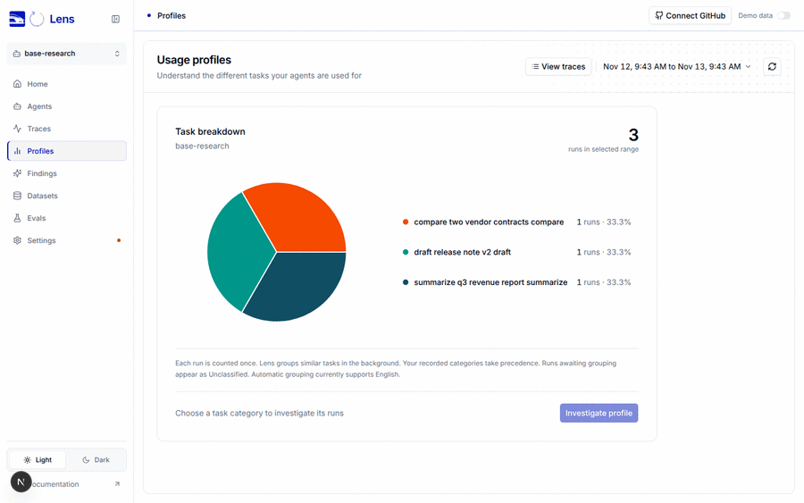
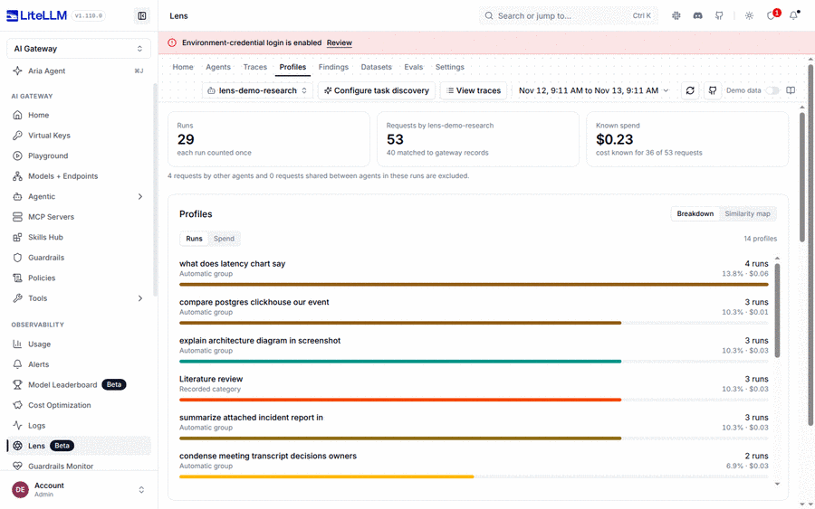
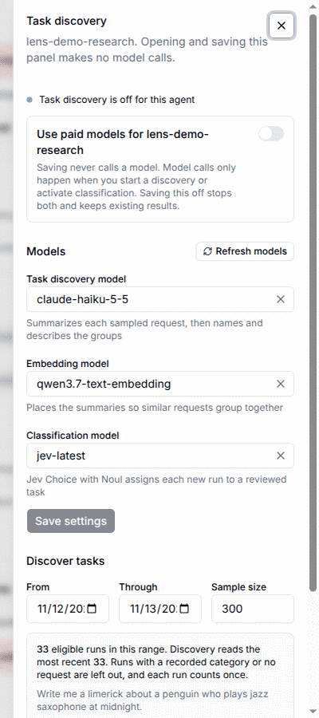

# Task discovery QA runbook

Tested commit `dc0a714f5f63d5b960141656ac112b02f05378b9` on `joshua-berri/lens:litellm_lens_task_profiles`, compared with `main` at `5109b59b5575a00d752a8dd3134211c573560069`. Later commits add regression tests, formatting, this runbook and its screenshots, and leave production behavior unchanged. The images in the parent folder belong to an earlier pull request and are not evidence for this one

## Reproduce

```bash
git checkout litellm_lens_task_profiles
bash deploy/profiles-demo/demo.sh             # builds Lens for this commit, LiteLLM on 4400, Lens on 4320, seeds sample data
bash deploy/profiles-demo/demo.sh password    # LiteLLM admin password
bash deploy/profiles-demo/demo.sh lens-token  # Lens admin token
```

The seeded sample data needs no provider keys and makes no model calls. A live discovery needs three aliases on the gateway in `deploy/profiles-demo/litellm-config.yaml`, with their keys in `deploy/profiles-demo/.env`: a chat model, a model reported with `mode: embedding`, and a Jev model (`typesafe` or `mode: decisions`). The run below used Claude Haiku, a Qwen3 embedding deployment and `typesafe/jev-latest`

Open `http://localhost:4400/ui`, choose the Lens tab, then Profiles, and pick an agent. **Configure task discovery** in the page header opens the settings panel. Count model calls in the LiteLLM spend logs by the `litellm-lens-profiles` request tag

## Screenshots

Before, on `main` at `5109b59`: a native build of that commit, served from source with demo data off, after three synthetic runs were ingested through OTLP. The Profiles page shows the usage pie with no way to configure discovery. Its health check returned 200, the new task discovery routes returned 404, and no paid model calls were made. It used a different and smaller fixture than the after screenshots, so their figures are not comparable



After, at the tested commit: the same page has **Configure task discovery** in the header and opens on the Breakdown view, ranked by runs with spend beside each profile. This environment had already been through the live run below, so its runs show automatic groups and the recorded category



After, the settings panel: task discovery is off for the agent, the three model pickers hold the gateway aliases, and the preview reports the eligible runs in the range with an example request, all without a model call



## What was checked at the tested commit

These are the steps of the live run, through the LiteLLM gateway, against an instrumented Lens build of the tested commit:

1. Opening the panel, previewing a range and saving settings made no model calls. The preview reported 20 of 32 eligible runs. Saving again from a stale form returned 409
2. Discovery with Haiku and Qwen drafted 3 tasks in about 30 seconds, with 4 Haiku calls and 1 embeddings call
3. Editing a task and replaying that edit with the old revision returned 409
4. Activating with the backfill box checked classified the 26 runs of the discovery range with 26 Jev calls within 40 seconds
5. Jev was called 26 times in the whole run, all for that backfill, so turning discovery off and then back on without **Resume classification for new runs** made no Jev calls. Resume reopened classification for new runs, and a resume sent with a stale revision was refused
6. Reset and a final turn-off behaved as documented
7. Overview and matrix returned 200. Invalid requests returned 400, and unauthenticated requests 401

## Automated checks at the tested commit

These are the exact commands that ran at the tested commit. Rust ran in a Wolfi container with rustc 1.99.1 from `src/worker`, built with `RUSTFLAGS="-C instrument-coverage"` and `CARGO_INCREMENTAL=0` for the coverage report. `CLICKHOUSE_STATE_TEST_URL` pointed at a Keeper-backed ClickHouse 26.9.6.6, the image digest CI pins, started from the same `keeper.xml` fixture the CI workflow uses

```bash
cargo fmt --all --check
cargo clippy --locked -p lens-server -p litellm-lens -p litellm-traces-clickhouse \
  -p litellm-storage-clickhouse -p lens-profiles -p litellm-traces --all-targets -- -D warnings
cargo test --locked -p lens-server --lib --test profile_taxonomy --test profile_routes --no-fail-fast
cargo test --locked -p litellm-lens --lib --no-fail-fast
CLICKHOUSE_STATE_TEST_URL=http://<clickhouse-with-keeper>:8123 \
  cargo test --locked -p litellm-lens --test profile_state --test profile_demo --no-fail-fast
cargo test --locked -p litellm-traces-clickhouse --test profile_selection --test profiles --no-fail-fast -- --test-threads=1
cargo test --locked -p litellm-storage-clickhouse --lib
cargo test --locked -p lens-profiles --lib --test clustering --no-fail-fast
cargo test --locked -p litellm-traces --test resolve
cargo run --locked --quiet -p litellm-traces --features schema --bin export-traces-schema -- --ui \
  > "$TMP/lens-traces.json" && diff -u ../../schema/lens-traces.json "$TMP/lens-traces.json"
cd ../ui/lib
npx vitest run --coverage.enabled --coverage.reporter=lcov src/components/lens/profiles \
  src/components/lens/data/demo src/components/lens/LensWorkspace.integration.test.tsx
npm run typecheck
cd ../../.. && npm run check:worker-contract && npm run check:trace-contract
```

| Check | Result |
| --- | --- |
| rustfmt, clippy on the six crates | clean |
| `lens-server` lib, `profile_routes`, `profile_taxonomy` | 348, 42 and 29 passed |
| `litellm-lens` lib, `profile_demo`, `profile_state` | 292, 4 and 2 passed |
| `litellm-traces-clickhouse` `profile_selection`, `profiles` | 6 and 16 passed |
| `litellm-storage-clickhouse` lib | 35 passed |
| `lens-profiles` lib, `clustering` | 6 and 17 passed, 1 test already ignored in the crate |
| `litellm-traces` `resolve` | 145 passed |
| Trace schema export | no diff |
| UI tests in the three paths above | 162 passed in 15 files |
| UI typecheck, worker and trace contract checks | clean |

Commit `3a0666dd14b682113db07e7e7bd2546e98b5dbd0` adds two tests and no production change to the tested commit. In its targeted rerun `lens-server` lib passed 350 tests, `profile_demo` 6 and `profile_state` 2, and clippy was clean on `lens-server` and `litellm-lens`. rustfmt asked for one line wrap in a new test, which the commit adding this runbook applies

The vitest command line is reconstructed from the run log, which recorded the matched files and results but not the raw arguments. These checks cover only the crates and test targets this branch touches. Nothing above used `--workspace`

## Broader checks for reviewers

These were not all run for this report. CI runs the full set on the pull request:

```bash
cd src/worker
cargo fmt --check
cargo clippy --locked --workspace --all-targets -- -D warnings
cargo test --locked --workspace --no-fail-fast -- --test-threads=2
cd ../.. && npm run check:worker-contract && npm run check:trace-contract && npm run typecheck:ui
```

## Coverage

Coverage counts only production lines this branch changed against `main`, with test modules and test files excluded. Rust is measured with LLVM line coverage

| Scope | Lines | Branches |
| --- | --- | --- |
| Rust, tests only | 2970 / 3399 (87.4%) | not measured on stable Rust |
| Rust, tests plus the live run above | 3311 / 3399 (97.4%) | not measured |
| UI | 553 / 580 (95.3%) | 578 / 669 (86.4%) |

The Rust totals combine the tested commit with the two tests added in `3a0666d`, which reach the request merge in `server/src/profiles/aggregate.rs` (308 of 310 changed lines) and the reviewed-task path in `lens/src/storage/sources.rs` (51 of 61)

The live run reaches the worker's discovery and classification loops, which have no separate unit harness. Their guards are tested directly. Most remaining uncovered lines are storage or provider error fall-throughs. Two closing lines of the request merge in `aggregate.rs` stay unreached by construction, because merging moves every charge of a merged request onto the surviving one, so neither a merged-away request nor a missing target can be found. In `sources.rs` the taxonomy load error and the fallback for an agent without an active taxonomy are not exercised

## Limitations

Rust branch coverage is not measured. The Docker `smoke` target, workspace-wide clippy and the full workspace test suite are left to CI. No Codecov report is available for this branch, and the checks that actually run will be read from the pull request once it is open. Grouping quality has not been measured against human labels
