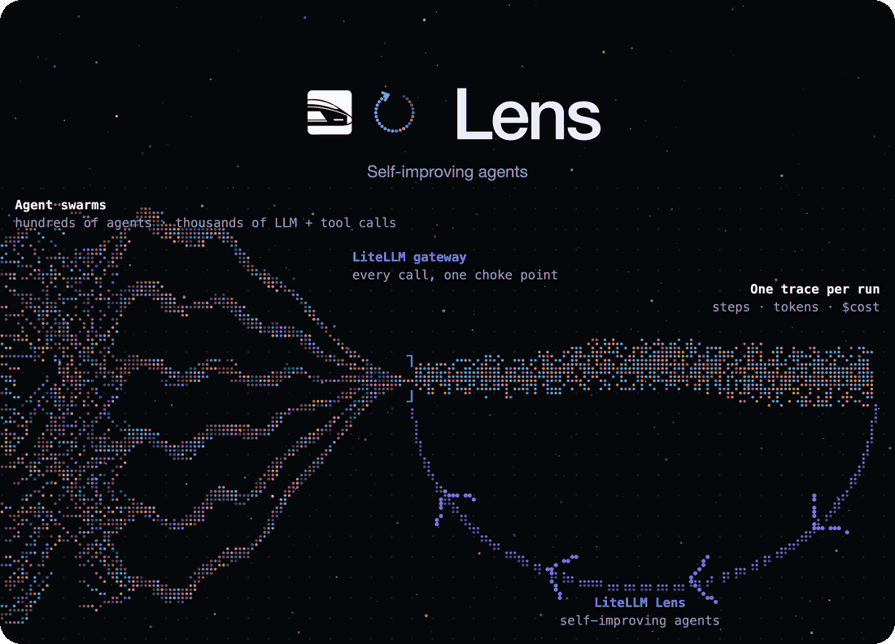
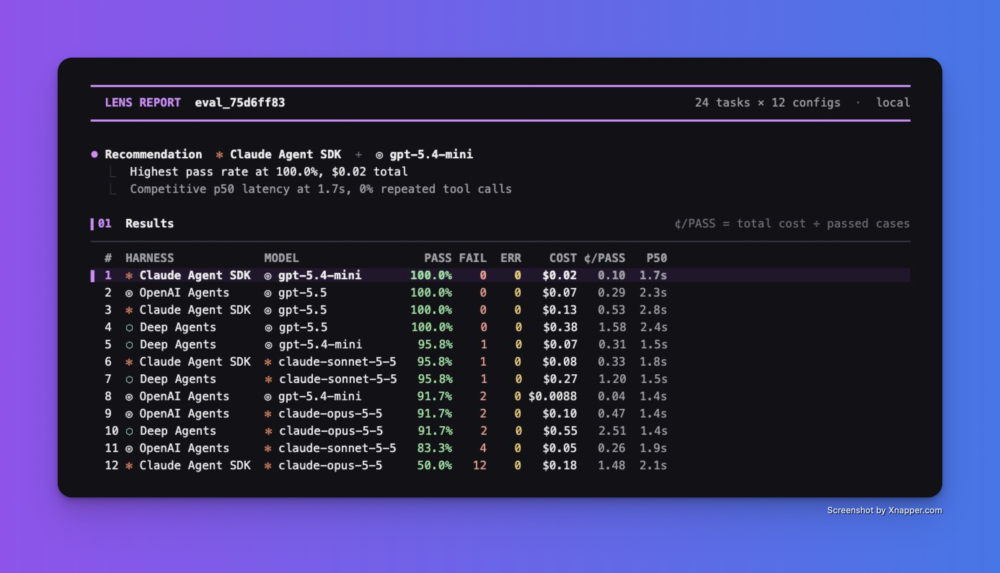
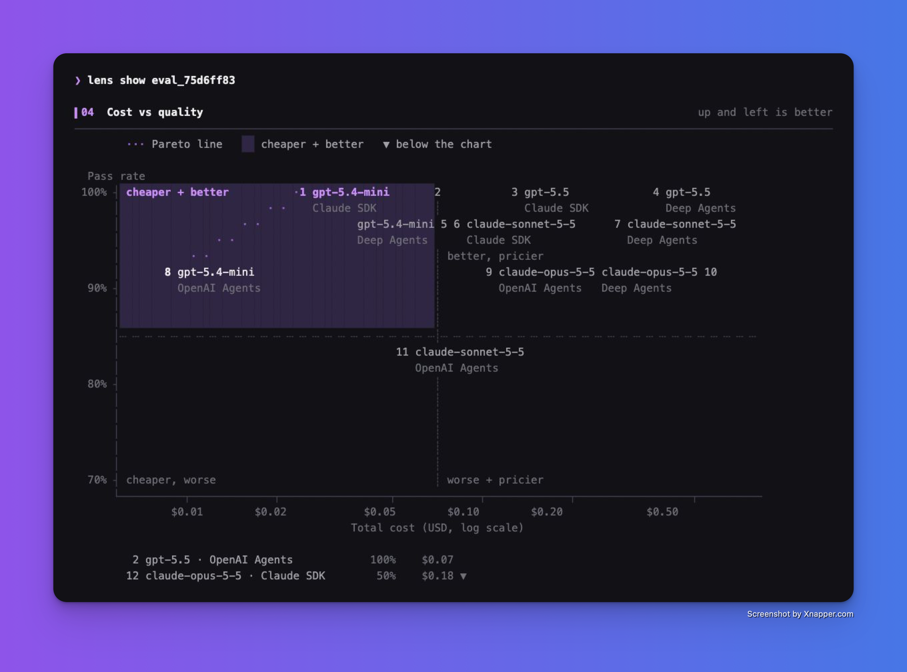
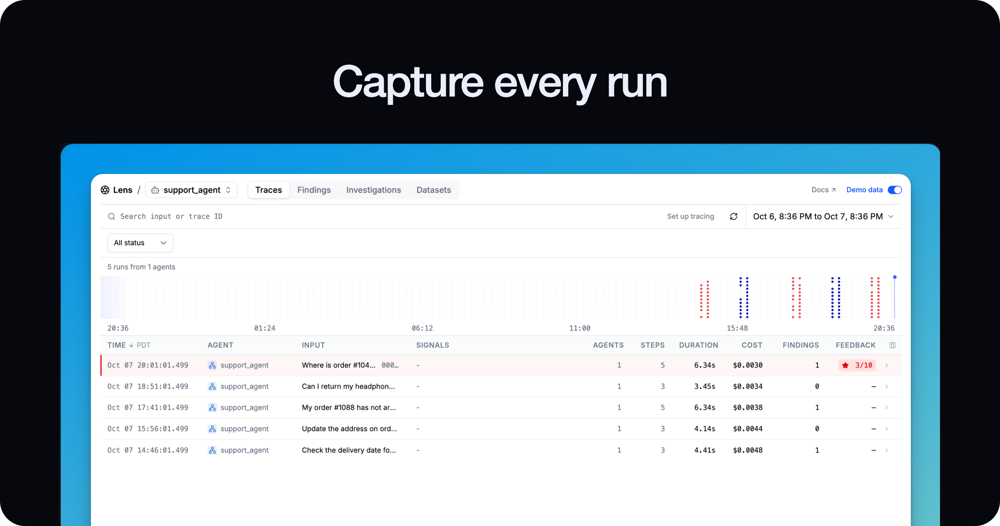
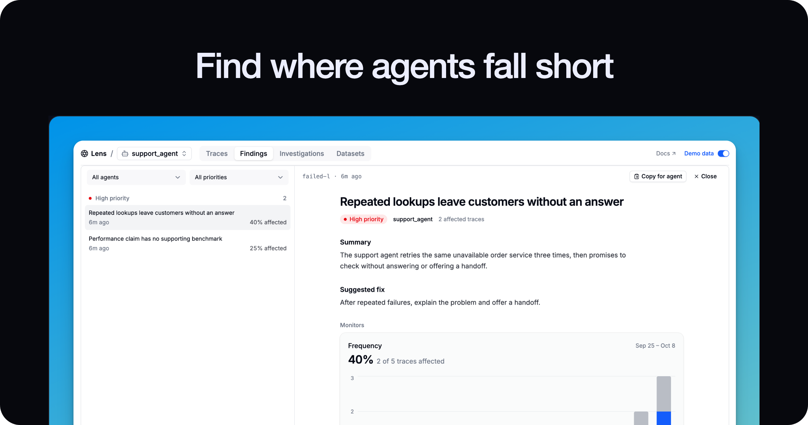
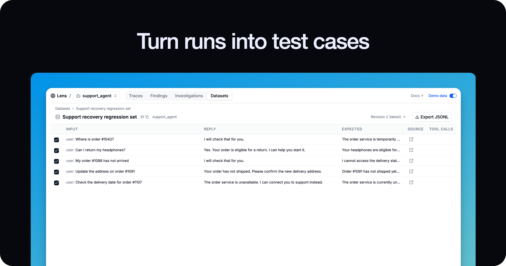
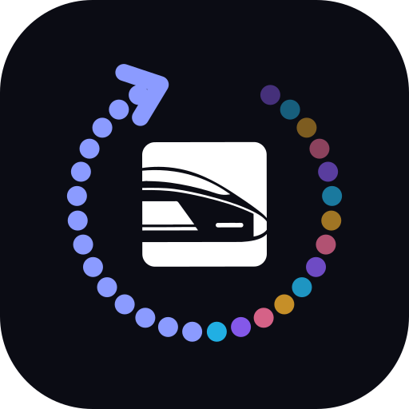

<div align="center">
  <a href="https://github.com/BerriAI/lens">
    <picture>
      <source media="(prefers-color-scheme: dark)" srcset="assets/lens-logo-dark.png">
      <source media="(prefers-color-scheme: light)" srcset="assets/lens-logo-light.png">
      
    </picture>
  </a>

<h3>Self-improving agents, on your infrastructure.</h3>

**[Start locally](#run-locally)** with Git and Docker, or **[Set it up for me](docs/setup-with-agent.md)** with your coding agent

<details>
<summary>Copy a setup prompt</summary>

```text
Set up Lens for this project using https://github.com/BerriAI/lens/blob/main/docs/setup-with-agent.md. Inspect the existing project and deployment first. Reuse a working Lens installation if one exists; otherwise start standalone Lens with ClickHouse using the documented quickstart. Ask only for consequential missing choices. Preserve configuration, data, secrets, and my agent's model connection. Connect this project's instrumentation and verify a real run by its trace ID, including its input, output, and tool calls. Report the Lens URL, changes made, and verification results without exposing credentials.
```

</details>

<br>



<br><br>

**Your agents run. Lens watches every run, finds what went wrong, and feeds it back.**<br>
**The next run is better.**

<br>

[Early access](https://forms.gle/3GC1Ner4vjthGWi18) &nbsp;&nbsp;·&nbsp;&nbsp; [Docs](deploy/lens/README.md) &nbsp;&nbsp;·&nbsp;&nbsp; [Contributing](CONTRIBUTING.md) &nbsp;&nbsp;·&nbsp;&nbsp; [Launch post](https://docs.litellm.ai/blog/litellm-lens-launch) &nbsp;&nbsp;·&nbsp;&nbsp; [4K film](assets/lens-hero-4k.mp4)

<br><br>

<h3>Lens CLI</h3>

**Evaluate models, harnesses, and custom agents on your own tasks**



Saved sample run: 24 synthetic tasks across 12 configurations, with token-based cost estimates

<br>



Compare pass rate and estimated cost before choosing a model and harness

[Try the CLI preview](https://docs.litellm.ai/docs/proxy/lens/cli)

<br><br>



<br><br>



<br><br>



<br><br>



<br>

**Run Lens on its own or open it inside LiteLLM.** Your traces stay in your own ClickHouse.<br>
Point Claude Code, [Codex](docs/codex-cli.md) or [OpenCode](docs/opencode.md) at them and let your agents improve your agents.

<br>

**Using Claude Code?** Its telemetry is off by default and Lens needs it to record your turns.<br>
[Turn on the required Claude Code settings](docs/claude-code.md) before your first session.

<br>

[Get started](deploy/lens/README.md)

</div>

## Run locally

Install Docker with Docker Compose 2.24 or newer and make sure Docker is running. Then run this from a checkout of this repository:

```sh
docker compose up --wait
docker compose logs -n1 credentials
```

The first command starts Lens and ClickHouse. The second prints the address to open and the setup token to paste there:

```
credentials-1  | Open http://localhost:4318/ui/ and paste this setup token: <your token>
```

The token is also saved as `LENS_ADMIN_TOKEN` in `deploy/lens/.env`. `docker compose down` stops Lens and keeps its data, and adding `--volumes` deletes the stored traces

See [Run Lens](deploy/lens/README.md) for recording your first trace and configuring a deployment
