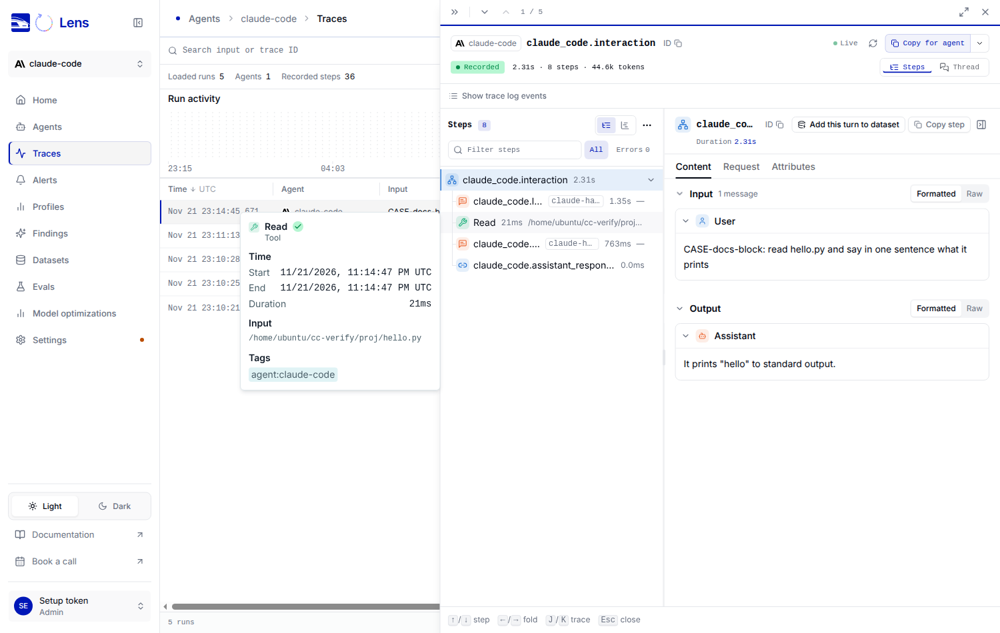

# Claude Code telemetry

Claude Code's telemetry is off by default, and Lens needs it to record Claude Code turns. Turn it on in every environment where you run `claude`. Without it Lens shows no turn, tool or subagent steps

There are two ways to run Lens, and each has one setup. Pick the one that matches where Claude Code's model calls go:

| | [Lens with LiteLLM](#lens-with-litellm) | [Lens with no gateway](#lens-with-no-gateway) |
| --- | --- | --- |
| Model calls go to | your LiteLLM gateway | Anthropic, with your own login or API key |
| Telemetry goes to | the same gateway, which forwards it to Lens | Lens |
| Telemetry key | your LiteLLM key | a Lens tracing key |
| Turn, model calls, tool calls, prompt, reply | yes | yes |
| Token counts | yes | yes |
| Cost | yes, from the gateway | no |

Do not mix the two. If Claude Code's model calls go through a LiteLLM gateway, send its telemetry to that gateway too and never straight to Lens. A turn sent straight to Lens belongs to whoever created the tracing key, so the gateway user it came from cannot see it beside their own model calls

## Lens with LiteLLM

Claude Code sends its telemetry to your LiteLLM gateway with the same gateway key it uses for model calls. The gateway forwards it to Lens. You do not put a Lens address or a Lens tracing key on the machine that runs Claude Code. The gateway must already be [connected to Lens](https://docs.litellm.ai/docs/proxy/lens/deployment/litellm)

### Required settings

Set these in the terminal where you run `claude`. Replace the gateway address and key with your own:

```sh
export ANTHROPIC_BASE_URL="http://localhost:4000"
export ANTHROPIC_AUTH_TOKEN="<your LiteLLM key>"

export CLAUDE_CODE_ENABLE_TELEMETRY=1
export CLAUDE_CODE_ENHANCED_TELEMETRY_BETA=1
export CLAUDE_CODE_PROPAGATE_TRACEPARENT=1
export OTEL_TRACES_EXPORTER=otlp
export OTEL_EXPORTER_OTLP_PROTOCOL=http/protobuf
export OTEL_EXPORTER_OTLP_TRACES_ENDPOINT="$ANTHROPIC_BASE_URL/v1/traces"
export OTEL_EXPORTER_OTLP_HEADERS="Authorization=Bearer $ANTHROPIC_AUTH_TOKEN"
export OTEL_LOG_USER_PROMPTS=1

claude -p "Reply with exactly: Lens telemetry check."
```

Every one of the telemetry variables is required. This is what each one does and what Lens shows when it is missing:

| Variable | What it does | Without it |
| --- | --- | --- |
| `CLAUDE_CODE_ENABLE_TELEMETRY=1` | Turns Claude Code telemetry on | No turn. Lens lists the gateway's model calls one by one |
| `CLAUDE_CODE_ENHANCED_TELEMETRY_BETA=1` | Turns on the trace exporter that sends turn, tool and subagent spans. The enable flag alone does not | No turn |
| `OTEL_TRACES_EXPORTER=otlp` | Sends those spans over OTLP | No turn |
| `OTEL_EXPORTER_OTLP_TRACES_ENDPOINT` | Where the spans go: your gateway address followed by `/v1/traces` | The exporter targets `localhost:4318` and nothing reaches your gateway |
| `OTEL_EXPORTER_OTLP_HEADERS` | Authenticates the upload with your LiteLLM key | The gateway rejects the upload |
| `OTEL_EXPORTER_OTLP_PROTOCOL=http/protobuf` | Uses the OTLP/HTTP format the gateway accepts | Claude Code's default export protocol is not guaranteed to match |
| `CLAUDE_CODE_PROPAGATE_TRACEPARENT=1` | Puts the turn's trace ID on each model call | The turn and its gateway calls show up as two unrelated traces |
| `OTEL_LOG_USER_PROMPTS=1` | Includes the text you typed | The turn's input reads `<REDACTED>` |

`OTEL_LOG_USER_PROMPTS=1` stores the prompts you type in Lens. They can contain source code or secrets, so use it only with a Lens deployment where you intend to keep that content

To keep the settings across terminals, put the same telemetry variables in the `env` object of your user-level `~/.claude/settings.json` and keep any settings already there:

```json
{
  "env": {
    "CLAUDE_CODE_ENABLE_TELEMETRY": "1",
    "CLAUDE_CODE_ENHANCED_TELEMETRY_BETA": "1",
    "CLAUDE_CODE_PROPAGATE_TRACEPARENT": "1",
    "OTEL_TRACES_EXPORTER": "otlp",
    "OTEL_EXPORTER_OTLP_PROTOCOL": "http/protobuf",
    "OTEL_EXPORTER_OTLP_TRACES_ENDPOINT": "http://localhost:4000/v1/traces",
    "OTEL_EXPORTER_OTLP_HEADERS": "Authorization=Bearer <your LiteLLM key>",
    "OTEL_LOG_USER_PROMPTS": "1"
  }
}
```

Do not set `OTEL_LOGS_EXPORTER`. The gateway accepts trace spans only and answers `POST /v1/logs` with `410`

Do not add `lens.session.capture=true` to `OTEL_RESOURCE_ATTRIBUTES` with this setup. Together with `CLAUDE_CODE_PROPAGATE_TRACEPARENT=1` it splits each turn into two traces: the turn under one trace ID and its gateway calls under another

### Check the result

Run one task, then open **Lens > Traces** in your LiteLLM dashboard, or **Traces** in standalone Lens, and filter by **claude-code**. A working setup shows one `claude_code.interaction` trace per turn, with the model calls and tool calls nested under it, the prompt you typed and the cost from the gateway


If you see only rows named `chat <model>` with no `claude_code.interaction` row, the telemetry settings did not reach the `claude` process. Run `env | grep -E 'CLAUDE_CODE|OTEL'` in the same terminal and compare the output with the block above

## Lens with no gateway

Claude Code keeps calling Anthropic with your own login or API key. It sends its telemetry straight to Lens with a Lens tracing key. Create the key in Lens under **Home > Set up manually**; a tracing key uploads telemetry and is not a model credential

### Required settings

Set these in the terminal where you run `claude`. Replace the Lens address and tracing key with your own:

```sh
export CLAUDE_CODE_ENABLE_TELEMETRY=1
export CLAUDE_CODE_ENHANCED_TELEMETRY_BETA=1
export OTEL_TRACES_EXPORTER=otlp
export OTEL_LOGS_EXPORTER=otlp
export OTEL_EXPORTER_OTLP_PROTOCOL=http/protobuf
export OTEL_EXPORTER_OTLP_ENDPOINT="http://localhost:4318"
export OTEL_EXPORTER_OTLP_HEADERS="Authorization=Bearer <your Lens tracing key>"
export OTEL_LOG_USER_PROMPTS=1
export OTEL_LOG_ASSISTANT_RESPONSES=1
export OTEL_LOG_TOOL_DETAILS=1
export OTEL_LOG_TOOL_CONTENT=1

claude -p "Reply with exactly: Lens telemetry check."
```

The first three telemetry variables and `OTEL_LOG_USER_PROMPTS` do the same job as in the gateway setup. These are the differences:

| Variable | Why it differs from the gateway setup |
| --- | --- |
| `OTEL_EXPORTER_OTLP_ENDPOINT` | Your Lens address with no path. Claude Code adds `/v1/traces` and `/v1/logs` itself. Keep any `/lens-ingest` prefix |
| `OTEL_EXPORTER_OTLP_HEADERS` | Carries a Lens tracing key, because there is no LiteLLM key |
| `OTEL_LOGS_EXPORTER=otlp`, `OTEL_LOG_ASSISTANT_RESPONSES=1` | Send the assistant's reply. With a gateway the reply comes from the gateway's own record of the model call. Without them the turn has no reply |
| `OTEL_LOG_TOOL_DETAILS=1`, `OTEL_LOG_TOOL_CONTENT=1` | Send tool arguments and results. Without them a tool step shows its name and timing only |
| `CLAUDE_CODE_PROPAGATE_TRACEPARENT` | Not needed. There are no gateway calls to join to the turn |

The content flags store your prompts, the assistant's replies, tool arguments and tool results in Lens. They can contain source code or secrets, so use them only with a Lens deployment where you intend to keep that content

To keep the settings across terminals, put the same variables in the `env` object of your user-level `~/.claude/settings.json`, as in the gateway setup

### Check the result

Run one task, then open **Traces** in Lens and filter by **claude-code**. A working setup shows one `claude_code.interaction` trace per turn with its model calls, tool calls, token counts, the prompt you typed and the reply. The cost column stays empty. Cost is recorded only when the model calls go through a LiteLLM gateway



Both setups verified with Claude Code 2.1.330
