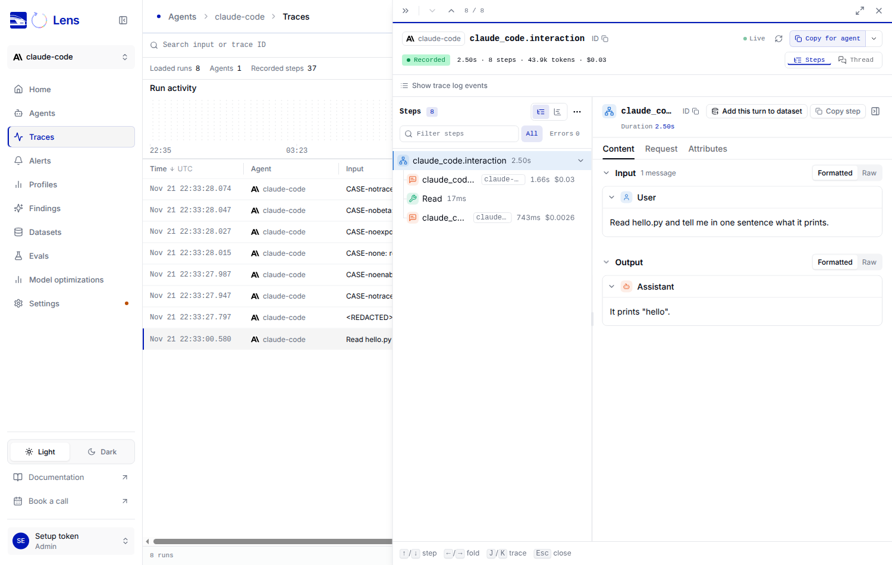

# Claude Code telemetry

Claude Code's telemetry is off by default, and Lens needs it to record Claude Code turns. Turn it on in every environment where you run `claude`. Without it Lens only sees the model calls that pass through your LiteLLM gateway and lists them as separate calls, with no turn, tool or subagent steps

Claude Code sends its telemetry to your LiteLLM gateway with the same gateway key it uses for model calls. The gateway forwards it to Lens. You do not put a Lens address or a Lens tracing key on the machine that runs Claude Code. The gateway must already be [connected to Lens](https://docs.litellm.ai/docs/proxy/lens/deployment/litellm)

## Required settings

The quickest way to set these is the setup prompt on the Lens home page: copy it and give it to Claude Code. To set them by hand, run this in the terminal where you run `claude` and replace the gateway address and key with your own:

```sh
export ANTHROPIC_BASE_URL="http://localhost:4000"
export ANTHROPIC_AUTH_TOKEN="<your LiteLLM key>"

export CLAUDE_CODE_ENABLE_TELEMETRY=1
export CLAUDE_CODE_ENHANCED_TELEMETRY_BETA=1
export CLAUDE_CODE_PROPAGATE_TRACEPARENT=1
export OTEL_TRACES_EXPORTER=otlp
export OTEL_LOGS_EXPORTER=otlp
export OTEL_EXPORTER_OTLP_PROTOCOL=http/protobuf
export OTEL_EXPORTER_OTLP_ENDPOINT="$ANTHROPIC_BASE_URL"
export OTEL_EXPORTER_OTLP_HEADERS="Authorization=Bearer $ANTHROPIC_AUTH_TOKEN"
export OTEL_LOG_USER_PROMPTS=1
export OTEL_LOG_ASSISTANT_RESPONSES=1
export OTEL_LOG_TOOL_DETAILS=1
export OTEL_LOG_TOOL_CONTENT=1
export OTEL_LOG_RAW_API_BODIES=1
export CLAUDE_CODE_OTEL_CONTENT_MAX_LENGTH=16777216

claude -p "Reply with exactly: Lens telemetry check."
```

This is what each telemetry variable does and what Lens shows when it is missing:

| Variable | What it does | Without it |
| --- | --- | --- |
| `CLAUDE_CODE_ENABLE_TELEMETRY=1` | Turns Claude Code telemetry on | No turn. Lens lists the gateway's model calls one by one |
| `CLAUDE_CODE_ENHANCED_TELEMETRY_BETA=1` | Turns on the trace exporter that sends turn, tool and subagent spans. The enable flag alone does not | No turn |
| `OTEL_TRACES_EXPORTER=otlp` | Sends those spans over OTLP | No turn |
| `OTEL_LOGS_EXPORTER=otlp` | Sends Claude Code's events over OTLP: assistant replies, tool results and model call bodies | Steps have no replies, tool output or model call content |
| `OTEL_EXPORTER_OTLP_ENDPOINT` | Where the spans and events go: your gateway address. Claude Code adds `/v1/traces` and `/v1/logs` | The exporter targets `localhost:4318` and nothing reaches your gateway |
| `OTEL_EXPORTER_OTLP_HEADERS` | Authenticates the upload with your LiteLLM key | The gateway rejects the upload |
| `OTEL_EXPORTER_OTLP_PROTOCOL=http/protobuf` | Uses the OTLP/HTTP format the gateway accepts | Claude Code's default export protocol is not guaranteed to match |
| `CLAUDE_CODE_PROPAGATE_TRACEPARENT=1` | Puts the turn's trace ID on each model call | The turn and its gateway calls show up as two unrelated traces |
| `OTEL_LOG_USER_PROMPTS=1` | Includes the text you typed | The turn's input reads `<REDACTED>` |
| `OTEL_LOG_ASSISTANT_RESPONSES=1` | Includes the text Claude Code replied with | The turn has no reply |
| `OTEL_LOG_TOOL_DETAILS=1` and `OTEL_LOG_TOOL_CONTENT=1` | Include each tool call's arguments and output | Tool steps show a name and a duration only |
| `OTEL_LOG_RAW_API_BODIES=1` | Includes the request and response of every model call | A model call step reads "No content recorded for this span" |
| `CLAUDE_CODE_OTEL_CONTENT_MAX_LENGTH=16777216` | Raises Claude Code's 60 KB limit on exported content to 16 MiB | Requests longer than 60 KB arrive cut off, and their model call step has no input |

## Model call content

With `OTEL_LOG_RAW_API_BODIES=1`, each model call step shows the conversation the request carried as its input and what the model returned as its output, which is usually the next tool call. Lens keeps the system prompt, the messages and the reply. It does not keep tool definitions or thinking blocks

Each request repeats the conversation so far, so a long session stores it once per model call. A request over the content limit arrives cut off and its step stays empty

These settings store what you type, what Claude Code replies, the files it reads and the output of the commands it runs. That content can include source code or secrets, so use them only with a Lens deployment where you intend to keep it. To leave model call bodies out, set `OTEL_LOG_RAW_API_BODIES=0`

To keep the settings across terminals, put the same telemetry variables in the `env` object of your user-level `~/.claude/settings.json` and keep any settings already there:

```json
{
  "env": {
    "CLAUDE_CODE_ENABLE_TELEMETRY": "1",
    "CLAUDE_CODE_ENHANCED_TELEMETRY_BETA": "1",
    "CLAUDE_CODE_PROPAGATE_TRACEPARENT": "1",
    "OTEL_TRACES_EXPORTER": "otlp",
    "OTEL_LOGS_EXPORTER": "otlp",
    "OTEL_EXPORTER_OTLP_PROTOCOL": "http/protobuf",
    "OTEL_EXPORTER_OTLP_ENDPOINT": "http://localhost:4000",
    "OTEL_EXPORTER_OTLP_HEADERS": "Authorization=Bearer <your LiteLLM key>",
    "OTEL_LOG_USER_PROMPTS": "1",
    "OTEL_LOG_ASSISTANT_RESPONSES": "1",
    "OTEL_LOG_TOOL_DETAILS": "1",
    "OTEL_LOG_TOOL_CONTENT": "1",
    "OTEL_LOG_RAW_API_BODIES": "1",
    "CLAUDE_CODE_OTEL_CONTENT_MAX_LENGTH": "16777216"
  }
}
```

## Check the result

Run one task, then open **Lens > Traces** in your LiteLLM dashboard, or **Traces** in standalone Lens, and filter by **claude-code**. A working setup shows one `claude_code.interaction` trace per turn, with the model calls and tool calls nested under it, the prompt you typed and the cost from the gateway. Select a model call to see the conversation it received and what the model returned



If you see only rows named `chat <model>` with no `claude_code.interaction` row, the telemetry settings did not reach the `claude` process. Run `env | grep -E 'CLAUDE_CODE|OTEL'` in the same terminal and compare the output with the block above

Verified with Claude Code 2.1.330
