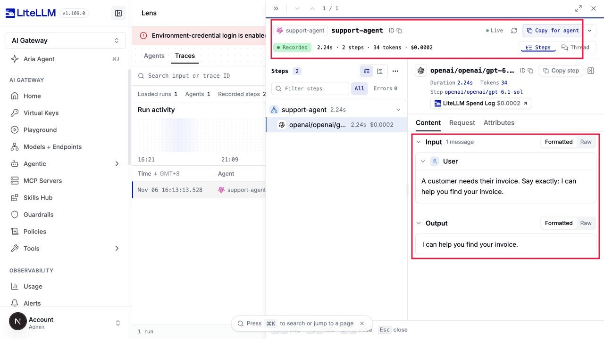

# Name an agent in LiteLLM

This preview requires the LiteLLM changes in [PR #50353](https://github.com/BerriAI/litellm/pull/50353). It uses your existing Postgres spend logs and the Lens view in the LiteLLM dashboard. You do not install a tracing SDK or a separate Lens service.

Add one header to the model client your agent already uses:

```python
default_headers={"x-litellm-agent-name": "support-agent"}
```

Every request from that client is recorded under **support-agent**. No agent registration or separate API key is required. Libraries often keep `Agent(name=...)` inside the application; use the same name in the header so LiteLLM receives it.

## Send a named run

Use your existing LiteLLM URL, virtual key, and model alias in `LITELLM_PROXY_API_BASE`, `LITELLM_PROXY_API_KEY`, and `LITELLM_MODEL`. With the OpenAI Python client already installed, run:

```python
import os
from uuid import uuid4
from openai import OpenAI

client = OpenAI(
    base_url=os.environ["LITELLM_PROXY_API_BASE"],
    api_key=os.environ["LITELLM_PROXY_API_KEY"],
    default_headers={
        "x-litellm-agent-name": "support-agent",
        "x-litellm-session-id": str(uuid4()),
    },
)
response = client.chat.completions.create(
    model=os.environ["LITELLM_MODEL"],
    messages=[{"role": "user", "content": "Help me find my invoice"}],
)
print(response.choices[0].message.content)
```

The agent name stays the same across runs. Use a new session ID for each run and keep it unchanged across the model and tool turns within that run. Without a shared session ID, requests appear as separate runs.

Open **Lens → Traces** in the LiteLLM dashboard and select **support-agent**. Open the run to see its model calls, tokens, cost, and recorded inputs and outputs. The same headers work with OpenAI Responses and Anthropic Messages clients that send requests through LiteLLM.



If you already send LiteLLM request metadata, `metadata.agent_name` supplies the same label. An explicit agent name takes precedence over an `agent:<name>` tag and a key's registered agent. These labels describe traffic; they do not change permissions or the key's managed identity.

LiteLLM must have Postgres spend logging enabled. Prompts and responses appear only when your deployment already records them, including `general_settings.store_prompts_in_spend_logs`. Enabling the agent name does not enable prompt storage. Existing logs keep the information originally recorded, so adding a name labels future requests. Tool results appear when they are present in subsequent recorded requests; local tool activity that never reaches LiteLLM is unavailable.
